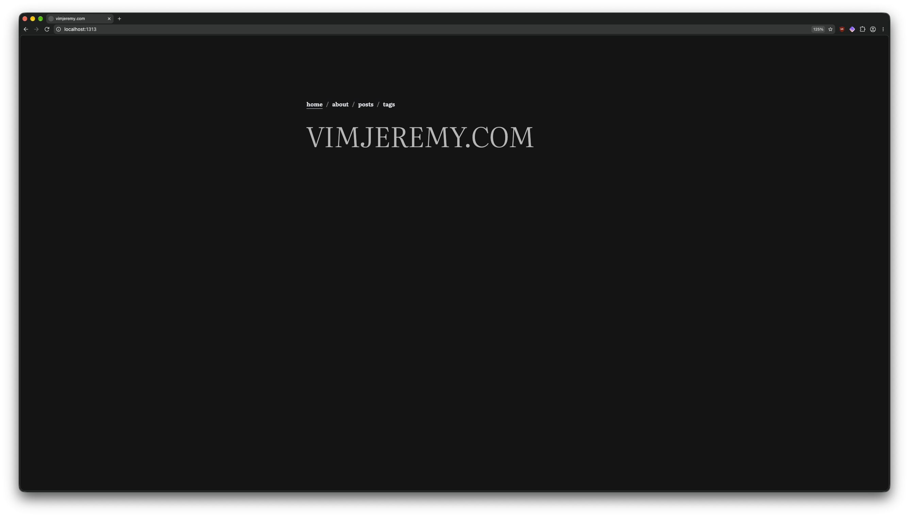

---
title: "How to use HUGO to make a blog website."
date: 2026-10-13
tags: ["hugo", "website", "blog", "first-post"]
draft: false
---
## Introduction
This post is about how I made this website to begin with. It's very simple to set up.

If you haven't caught it already, this website is made with [HUGO](https://github.com/gohugoio/hugo), which is a static website generator that, in this case, converts markdown files I write in [Obsidian](https://obsidian.md/) to HTML files for use with the website.


So why did I decide on HUGO? Well, I had 3 goals in mind when I was making this website:

1. Make it simple for me to write blog posts, preferably in something I already know.
2. Make it fall easily into my established workflow.
3. Be easy to set up.

HUGO accomplishes all of those things. It supports markdown, which is **very** easy to learn; it makes it so I can use Obsidian, which I already use as my note-taking app to write blog posts; and it is really easy to set up and I mean really, really easy.

So in this initial post I am going to guide you on how you can make a similar website to mine.

## Prerequisites

For making such website you will need:
- [Obsidian.](https://obsidian.md/)
- [Git.](https://git-scm.com/)
- [HUGO.](https://github.com/gohugoio/hugo)
- A terminal emulator.
- A code editor, I use [Zed](https://zed.dev), although probably this will become outdated. 
- A [Github](https://github.com/) account.

## Initial setup

Now that we have the prerequisites installed, we can start making the website.
First navigate to the folder you want to keep the website in using the terminal. For me, that's Documents, so I will run: 
```bash
cd ~/Documents
```

Now to initialize the website, we run:
```bash
hugo new site vimjeremy.com
cd vimjeremy.com
```
Feel free to substitute the URL of the website for your own
### Installing a theme.

Now that we're in the website folder, its time to pick a theme. I went with [not-much.](https://github.com/imgios/not-much/tree/main) All themes have the same install steps. Add it into the `themes` directory as a submodule, and append it as a theme to the config file. Before we do that though, we have to initialize a git repo.
```bash
git init
```

Now, we clone the theme. Substitute the repo of the theme for the one you picked.
```bash
git submodule add https://git.andy.sb/nojs.git ./themes/nojs
```

Next, we have to edit the `hugo.toml` config file with the name of our theme and some basic sections. For this theme, the example config file is in `$themeDir/exampleSite/config.toml`.

```toml
title = "title"
theme = "not-much"
baseURL = "https://example.org/"
copyright = "Copyright © {year}"

defaultContentLanguage = "en"
defaultContentLanguageInSubdir = false

[languages]
  [languages.en]
    languageName = "English"
    locale = "en"
    weight = 1
    [languages.en.params.giscus]
    language = "en"

[markup]
  [markup.highlight]
    style = 'dracula'
  [markup.goldmark]
    [markup.goldmark.renderer]
      unsafe = true

[params]
theme = "auto"
palette = "eink"
showThemeNotice = true
showPostsSummary = true

# Giscus Comment System
[params.giscus]
repository = "username/repository"
repositoryId = "repositoryId"
categoryName = "categoryName"
categoryId = "categoryId"
mapping = "pathname"
theme = "preferred_color_scheme"
# language = "en" is configured directly under languages.<languageCode>.params.giscus
lazyLoading = true

# Navigation
[menu]
  [[menu.main]]
    identifier = "home"
    name = "home"
    title = "Home"
    url = "/"
    weight = 1
  
  [[menu.main]]
    identifier = "posts"
    title = "posts"
    url = "/posts"
    weight = 3
  
  [[menu.main]]
    identifier = "about"
    title = "About"
    url = "/about"
    weight = 2
  
  [[menu.main]]
    identifier = "tags"
    title = "tags"
    url = "/tags"
    weight = 4
```
I cleaned it up a bit here. You can now look through it and edit what interests you.

Now let's make the posts directory and run the server.
```bash
mkdir -p content/posts
cat << EOF >> content/posts/test.md
---
title: "test"
draft: false
---
hello
EOF

hugo server --disableFastRender
```

Bang! We have a working website! Open the link it gives you in the command output usually [this](http://localhost:1313).


## Tweaks
Although this is a functioning website, there is still a lot we need to add.
1. Create some pages and directories
2. Sync with obsidian
3. Fix image rendering

### Creating extra pages and directories
I'll start with this since it's the easiest. Let's create the home page.
Create `content/_index.md`. I'll simply add a `H3` heading with a slogan.

Now for the about page create `content/about/_index.md`. This is where I'll put my links and a little description of myself.

Finally, create a `content/posts` directory to store our posts.

### Syncing with Obsisian
This is (probably) the longest part. First, we need to create a folder in our vault. Name it whatever you want. I named mine `blog-posts`. Now we need to create a shell script for copying the files from our vault to our website. Remember to place it in the root of the website's folder or else it won't work.

```bash
#!/bin/bash
# Copies your Obsidian posts into the Hugo site.
#
# Usage:
#   ./sync-posts.sh            copy for real
#   ./sync-posts.sh --dry-run  only show what WOULD change, copy nothing

# Stop at the first error, and treat unset variables as errors.
set -euo pipefail

# Where your posts live in Obsidian (the trailing / matters, see below).
SOURCE=""

# Where Hugo reads posts from: "content/posts" next to this script.
# $(dirname "$0") is the folder this script is in, so it works from anywhere.
DEST="$(cd "$(dirname "$0")" && pwd)/content/posts/"

# Refuse to run if the source folder is missing. Otherwise --delete below would
# make the destination match an empty folder and wipe all your posts.
if [ ! -d "$SOURCE" ]; then
  echo "Error: can't find $SOURCE" >&2
  exit 1
fi

mkdir -p "$DEST"

# -a  archive: copy folders recursively and keep timestamps
# -v  verbose: list each file that is copied or removed
# --delete  remove files from DEST that are no longer in SOURCE (a true mirror)
# --exclude  skip Obsidian's hidden settings folder and macOS junk files
# "$@"  passes along anything you typed after the script name, like --dry-run
rsync -av --delete \
  --exclude='.obsidian' \
  --exclude='.DS_Store' \
  "$@" \
  "$SOURCE" "$DEST"

echo "Done."
```

Now right click on the folder in Obsidian and select "Copy path from system root" and paste it into the `SOURCE` variable. Save the script and `chmod +x` it.

### Rendering Images.

This is pretty simple. First, create `layouts/_markup/render-image.html` and paste this HTML code.
```html
{{- /* Overrides the theme's image template. In Obsidian an image path is relative
       to the note file (./my-post/pic.png), but on the built site the post is its
       own folder, so that path points to the wrong place. For relative paths we
       look the file up by name among the post's own files and use its real
       published address. Web links (https://...) and /absolute paths are left alone. */ -}}
{{- $src := .Destination -}}
{{- $u := urls.Parse $src -}}
{{- if and (not $u.Scheme) (not (hasPrefix $src "/")) -}}
  {{- with .PageInner.Resources.Get (path.Base $u.Path) -}}
    {{- $src = .RelPermalink -}}
  {{- end -}}
{{- end -}}
<figure>
  
  {{ if .Title }}
    <figcaption>{{ .Title }}</figcaption>
  {{- end }}
</figure>
```

Next and **DO NOT SKIP THIS**, open Obsidian's settings and disable the "Use Wikilinks" option. Now images should render without any problems.

## Making it available to the public.

Remember that account we made on Github? This is where we use it. Create a repository using the "+" icon on Github's website. Set the visibility to public and name it the URL of your website. 

Now we can stage and commit our changes.
```bash
git add .
git commit -m "Created website."
git remote add origin <url>
git push -u origin <branch>
```

I'll use Cloudflare pages for my domain, since that's where i have my domain. You can use any static hosting provider, tho.

The process is the same. Link the Github repo and change the folder to `/public`. You can usually leave the rest blank. Now it's available at [vimjeremy.com](https://vimjeremy.com). Hooray!
## Workflow

```bash
cd ~/Documents/vimjeremy.com
./sync-posts.sh
hugo
git add .
git commit -m "Added post."
git push
```